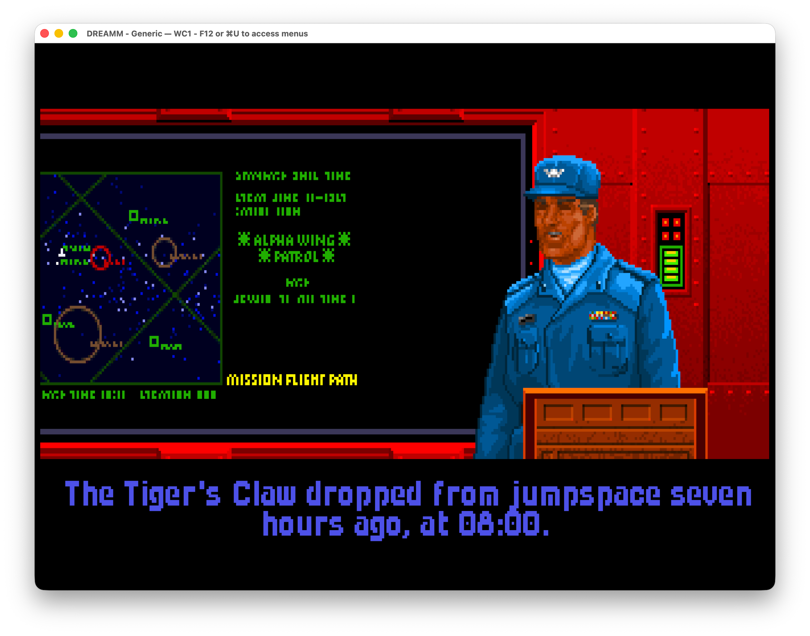
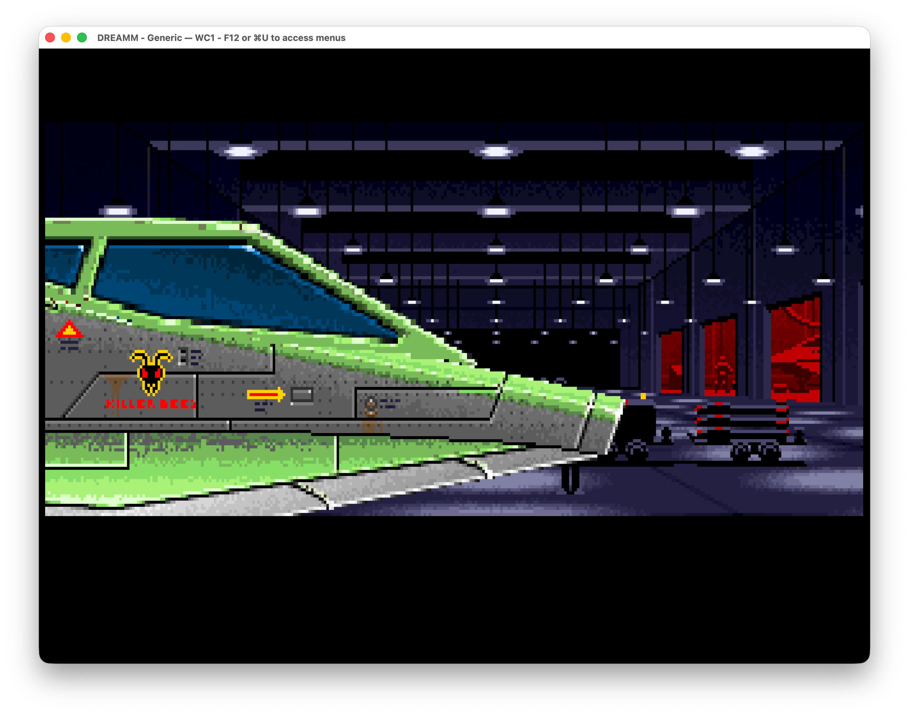
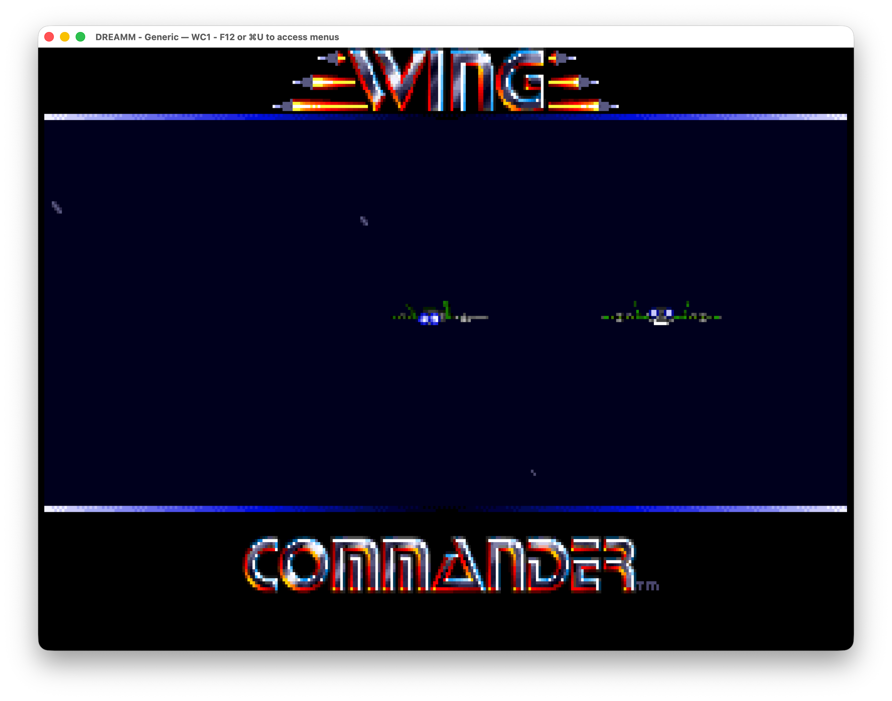
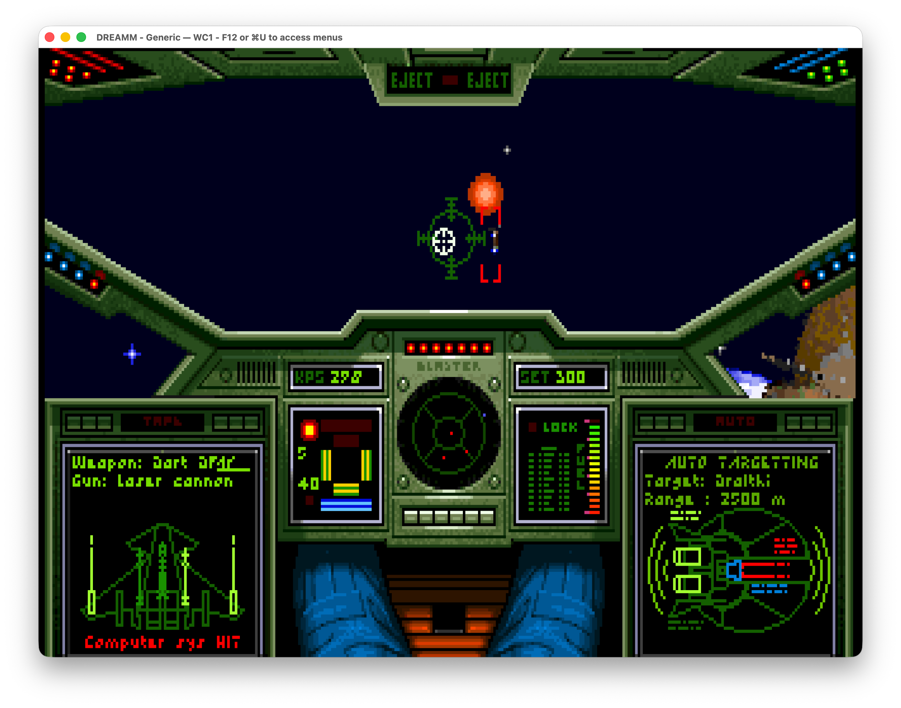
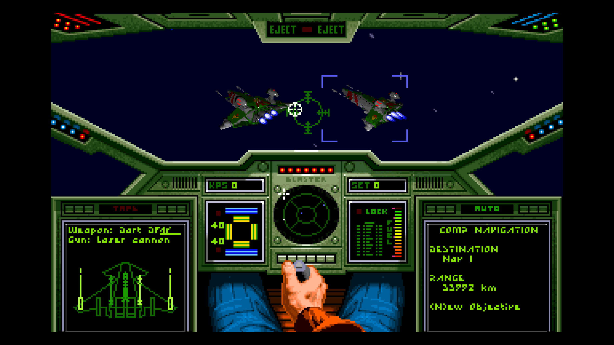
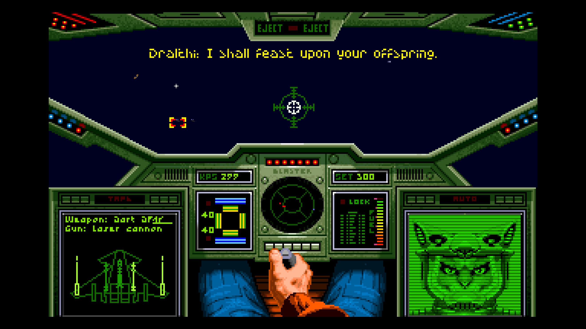

# Wing Commander source reconstruction and SDL2 port

This project recreates the source of **Wing Commander** as shipped in *Wing
Commander: The Kilrathi Saga* (1996). The reconstructed game core is C, the
`ix` audio library is C++, and the reference build uses Microsoft Visual C++
4.20 to reproduce the original Win32 executable.

A native SDL2 port is available for Windows, Linux, and macOS. It supports
Kilrathi Saga data, has partial support for the original DOS game data, and
also runs the Super Wing Commander Mac demo.

No copyrighted game data is included.

If you find this project useful, you can [support its development through
GitHub Sponsors](https://github.com/sponsors/neuromancer).

## Status

The reconstruction has reached **100% executable similarity**: the rebuilt
`WC1.EXE` matches the original byte for byte (all 518,656 bytes, SHA-256
`d517169e57f1d6254682c03dec5c254b5101ccd787d191f639b0cac1e8a616c4`).
A few matching workarounds remain in the source:

- one compilation unit (LOGIC) still selects its own header context;
- a four-instruction inline assembly block in the guarded memory allocator;
- some `volatile` qualifiers and access casts; and
- header declaration order and include placement chosen to reproduce the
  compiler's internal symbol ordering, plus three prototypes that nothing
  calls but that ordering still needs.

## Screenshots

| Mission briefing | Tiger's Claw hangar |
| --- | --- |
| [](screenshots/mission-briefing.png) | [](screenshots/tigers-claw-hangar.png) |

| Title sequence | Cockpit combat |
| --- | --- |
| [](screenshots/title-screen.png) | [](screenshots/cockpit-combat.png) |

## Download and run the SDL2 port

Download the archive for your platform from
[GitHub Releases](https://github.com/neuromancer/wc1-re/releases), extract it,
and keep the bundled runtime libraries beside the executable. Started without
arguments, it opens a graphical launcher: use **Browse…** to select a Kilrathi
Saga or DOS Wing Commander directory containing `GAMEDAT`, choose the graphics
and joystick options, and select **Start game**. Kilrathi Saga installations
also need `STREAMS/PREFLITE.STR`, `POSFLITE.STR`, and `MISSION.STR`. With DOS
data, compressed resources, OriginFX/AdLib music, and synthesized sound effects
work; other DOS-specific data or behavior may not. Starting the game saves the
directory and options for the next session.

With command-line arguments the game starts directly from the working
directory; add `--gui` to review the options in the launcher first:

```sh
cd /path/to/WC1
./wc1-modern --enhanced --joystick-rumble
```

The Super Wing Commander Mac demo supports the same options except EGA
dithering. To play it, download the zip from
[archive.org](https://archive.org/details/super-wing-commander-demo-1.0.2-mac), unzip it,
and select its `SuperWing DEMO` folder in the launcher. Its Options commands keep
their original keys: `Cmd+U`/`Cmd+N` (`Ctrl+U`/`Ctrl+N` on Windows and Linux) turn
music and sound off or on, `Cmd+B`/`Ctrl+B` toggles text messages, and
`Cmd+V`/`Ctrl+V` opens Volume Controls.

### Fixes and features

The first group is always active; the rest need a switch, and switches can be
combined.

| Fix or feature | Enable with |
| --- | --- |
| Runs from either Kilrathi Saga or DOS game data, detected automatically | always on |
| Resizable window, fullscreen toggle, and mouse capture | always on |
| Aspect-correct 4:3 presentation and pointer mapping | always on |
| Camera-relative left/right panning for in-flight sound effects | always on |
| Kilrathi Saga sound effects balanced against streamed music | always on |
| Background planets drawn with correct per-object scaling (WCDX fix) | always on |
| Static on knocked-out cockpit displays, which the 1996 port dropped | always on |
| Landing on the *Tiger's Claw* from any bearing; retail also required the Claw's bow to face you | always on |
| Mouse wheel throttle control during spaceflight | always on |
| `Esc` pauses during spaceflight, where the original left it inert | always on |
| Pointer confined only during unpaused, focused spaceflight | always on |
| Gamepad support with automatic SDL mappings and hot-plug | always on |
| OpenGL renderer drawing space objects at output resolution | `--enhanced` |
| EGA 16-colour dithering | `--ega` |
| Restored, music-synchronized startup intro | `--enhanced`, or automatic with DOS data |
| OriginFX intro music | `--enhanced`, or automatic with DOS data |
| Heavy-weapon, damage, collision, and afterburner rumble | `--joystick-rumble` |
| WCAT-style four-button joystick layouts | `--joystick-mode=4button-2axis` or `4button-4axis` |
| Alternate twin-stick, HOTAS, throttle, and rudder axis layouts | `--joystick-axes=<layout>` |
| Joystick diagnostics on stderr | `--joystick-debug` |
| Cockpitless view | `-c` |
| Cheat mode: player invulnerability and no player collisions | GUI checkbox or `--cheats` |

The enhanced renderer keeps the original indexed artwork, palettes, cockpit,
and HUD; only space objects are redrawn at output resolution.

| Output-resolution ships | Cockpit combat |
| --- | --- |
| [](screenshots/enhanced-space-objects.webp) | [](screenshots/enhanced-cockpit-combat.webp) |

### Controls

| Shortcut | Action |
| --- | --- |
| `Cmd+Enter` (macOS), `Alt+Enter` (Windows and Linux) | Toggle fullscreen |
| `Cmd+Q` (macOS) | Quit the game |
| `Ctrl+S` / `Ctrl+M` (spaceflight) | Toggle sound effects / music |
| `Esc` (spaceflight) | Pause; press any key to resume |
| Mouse wheel (spaceflight) | Increase or decrease speed |
| Gamepad Start (spaceflight) | Pause or resume |
| Gamepad Back | Escape/back |
| Gamepad Y (`Y/N` prompts) | Confirm Yes |

As in the original, a mission ends only by landing on the *Tiger's Claw*,
ejecting, or dying; quit from the barracks menu.

The default `--joystick-mode=original` keeps the original two-axis, two-button
controls. The WCAT-style layouts use buttons 1–4 (A, B, X, Y on mapped
controllers) for fire, missile, afterburner, and either a roll/throttle
modifier (`4button-2axis`) or target cycling with extra roll and throttle axes
(`4button-4axis`). LB/RB cycle guns and missiles, LT/RT open the navigation map
and engage autopilot, and the D-pad provides full speed, stop, communications,
and target lock. `--joystick-axes=` selects `twin-stick-roll` (the default),
`twin-stick-yaw`, `hotas-yaw`, `hotas-roll`, `linear-throttle`, `rudder-yaw`, or
`rudder-roll`.

## Build from source

Clone the submodules first:

```sh
git submodule update --init --recursive
```

### SDL2 port

Install a C/C++ compiler plus the SDL2 and LZO2 development packages, then run
`make -j modern`. The executable is written to `out-modern/wc1-modern` (`.exe`
on Windows); `make run-modern` launches it with Kilrathi Saga data in
`data/full`, and `make run-modern-dos` with DOS data in `data/dos`.

The graphical launcher (`make -j modern-gui`) also needs CMake 3.21+, Rust
1.88+, and a C++20 compiler; Linux builds need the D-Bus and Fontconfig
development packages. It produces `out-modern/wc1-modern-gui`, which release
archives ship as `wc1-modern`.

### Reconstructed Win32 build

`make -j` builds `WC1.EXE` with the original MSVC 4.20 toolchain under wibo and
assembles the hand-written raster library with UASM. Each link checks the
executable against the original SHA-256; `make verify-hash` repeats the check.
To run it in an emulated Windows 95 environment through DREAMM, provide a
Kilrathi Saga disc image:

```sh
make run GAME_ISO=/path/to/kilrathi-saga.iso
```

### Reconstruction workflow

[`binary-comp`](https://github.com/gg-sl-oss/binary-comp) is required for the
assembly and layout comparisons. These commands also need the retail executable
at `data/full/WC1.ORI.EXE` and the original-code exports under `code-full/`:

```sh
python3 -m pip install "binary-comp[all] @ git+https://github.com/gg-sl-oss/binary-comp.git"
make compare-func FUNC=perform_maneuver
make verify
```

## Acknowledgements

Special thanks to:

- [Origin Systems](https://en.wikipedia.org/wiki/Origin_Systems)
  who created *Wing Commander* and developed its *Kilrathi Saga* port;
- [Electronic Arts](https://www.ea.com/) for publishing *Wing Commander: The
  Kilrathi Saga*;
- [GOG](https://www.gog.com/en/game/wing_commander_1_2) for keeping *Wing
  Commander 1 + 2* readily available;
- AllTinker for the [W.C.A.T. overhaul](https://alltinker.itch.io/wcat), whose
  fixes and analysis of the DOS release have been valuable references;
- the [WCDX project](https://github.com/Bekenn/wcdx) for its pioneering
  compatibility work on the *Kilrathi Saga* release;
- Aaron Giles for the [DREAMM emulator](https://dreamm.aarongiles.com/), used
  to run and study the original release, and
  [ymfm](https://github.com/aaronsgiles/ymfm), which powers the SDL2 port's
  AdLib emulation; and
- DaisenryakuFan for providing very advanced source reconstructions for the DOS
  releases of several *Wing Commander* titles.

## License

See [LICENSE](LICENSE). OpenAI Codex and Anthropic Claude were used during the
reconstruction.
