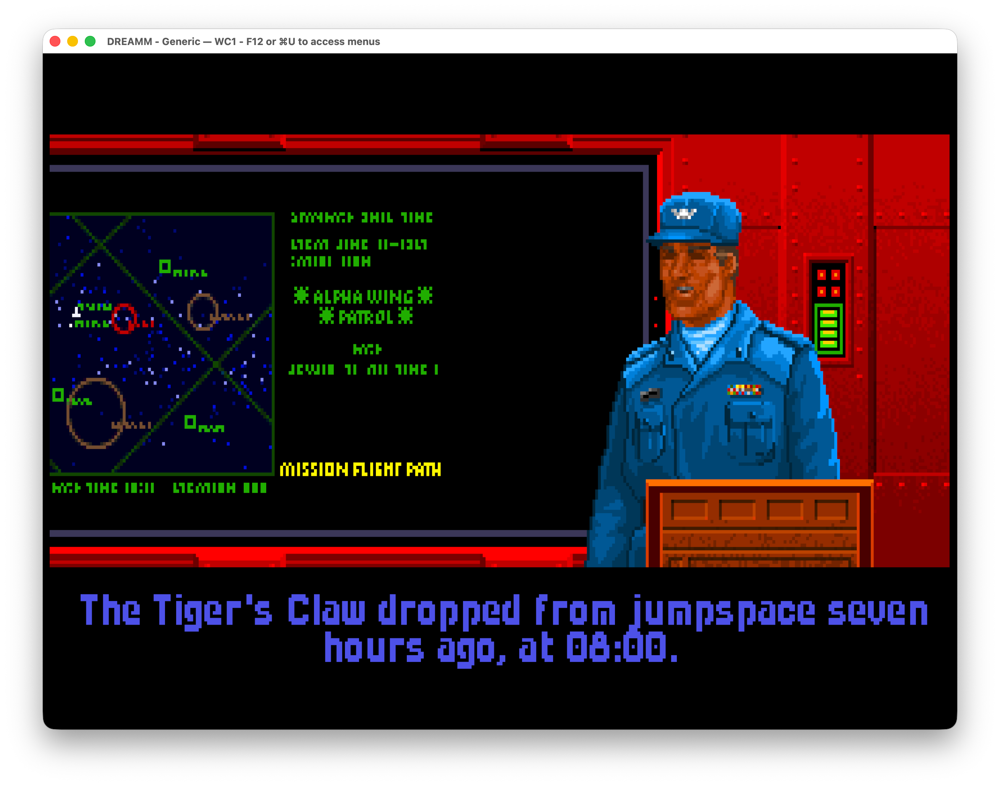
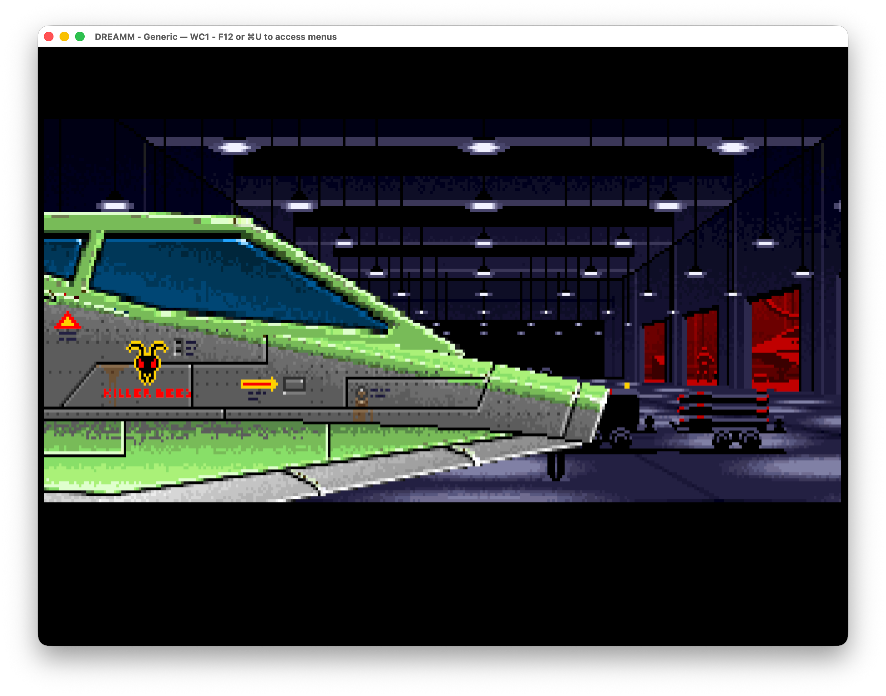
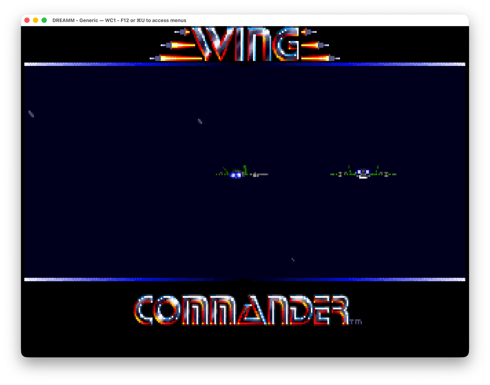
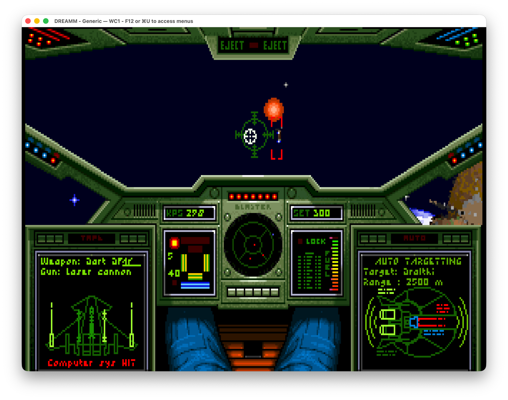
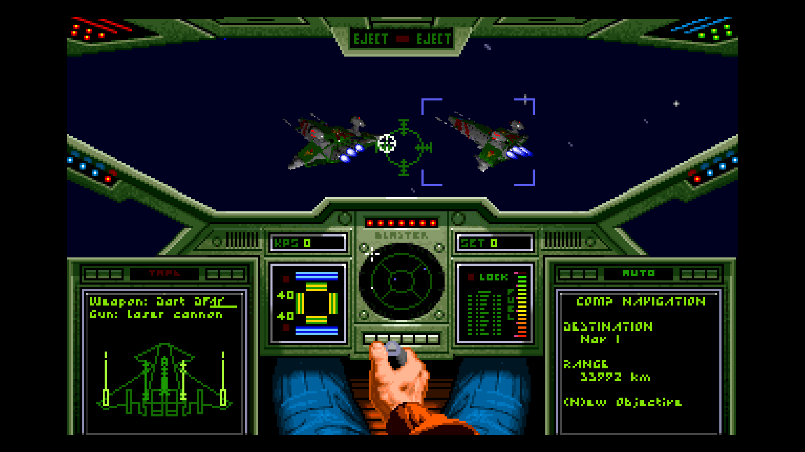
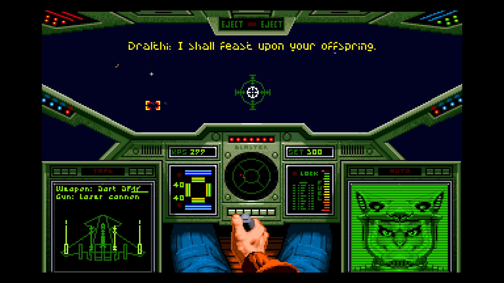

# Wing Commander source reconstruction and SDL2 port

This project recreates the source of **Wing Commander** as shipped in *Wing
Commander: The Kilrathi Saga* (1996). The reconstructed game core is C, the
`ix` audio library is C++, and the reference build uses Microsoft Visual C++
4.20 to reproduce the original Win32 executable.

A native SDL2 port is available for Windows, Linux, and macOS. It supports
Kilrathi Saga data and has partial support for the original DOS game data.

No copyrighted game data is included.

If you find this project useful, you can [support its development through
GitHub Sponsors](https://github.com/sponsors/neuromancer).

## Status

The reference build matches the original executable byte for byte: all
518,656 bytes are identical. The final three register-encoding differences
are resolved by a four-instruction inline assembly block in the guarded
allocator. This is a documented matching workaround; it does not establish
that the original source used assembly there. See the
[allocator matching exception](docs/PATTERNS.md#guarded-allocator-inline-assembly).

The [workaround removal workflow](docs/WORKAROUNDS.md) tracks the remaining
header exceptions and the exact-match checks required for each cleanup.

`make report` calculates per-function machine-code similarity to the retail
executable. It covers annotated functions and can miss unreconstructed code
between them. Use `make compare` to check executable layout as well, and
`binary-comp byte-compare data/full/WC1.ORI.EXE WC1.EXE` to verify the complete
file. These checks do not measure SDL port gameplay completeness.

## Similarity

Run `make report` for the current per-function results. Generated report output
is not stored in this repository.


## Screenshots

| Mission briefing | Tiger's Claw hangar |
| --- | --- |
| [](screenshots/mission-briefing.png) | [](screenshots/tigers-claw-hangar.png) |

| Title sequence | Cockpit combat |
| --- | --- |
| [](screenshots/title-screen.png) | [](screenshots/cockpit-combat.png) |

## Download and run the SDL2 port

Download the archive for your platform from
[GitHub Releases](https://github.com/neuromancer/wc1-re/releases). Extract its
contents and keep the bundled runtime libraries beside the executable. New
release builds open a graphical launcher when started without arguments. Use
**Browse…** to select an installed Kilrathi Saga or DOS Wing Commander directory
containing `GAMEDAT`, choose the graphics and joystick options, and select
**Launch WC1**. Older releases require the game directory as the working
directory:

```sh
# macOS or Linux
cd /path/to/WC1
./wc1-modern
```

```powershell
# Windows PowerShell
cd C:\path\to\WC1
.\wc1-modern.exe
```

With DOS data, compressed packet resources, OriginFX/AdLib music, and
synthesized sound effects work; other DOS-specific data or behavior may not.

The launcher follows WC2's layout, with WC1's enhanced OpenGL renderer, EGA
dithering, cockpitless view, cheat mode, joystick modes, axis layouts, and
rumble. Kilrathi Saga installations also need `STREAMS/PREFLITE.STR`, `POSFLITE.STR`, and
`MISSION.STR`. Clicking Launch saves the selected directory and these options
in a per-user `launcher.ini` for the next GUI launch. See
[launcher settings](docs/SDL2.md#launcher-settings) for the file location and format.

The [Super Wing Commander Mac demo](docs/SWC.md) also supports OpenGL,
cockpitless view, cheat mode, the joystick modes and axis layouts, and rumble.
Select its directory in the launcher or use `--swc-demo DIRECTORY` with the same switches.
EGA dithering applies only to WC1 data.

Providing command-line arguments starts the game directly from the working
directory. Add `--gui` to review those options in the launcher first; changing
a control overrides its command-line default. Explicit command-line options
override remembered settings; direct launches do not read or write the INI file.

### Fixes and features

What the port adds on top of the reconstructed game. The first group is always
active; the rest need a switch, and switches can be combined.

| Fix or feature | Enable with |
| --- | --- |
| Runs from either Kilrathi Saga or DOS game data, detected automatically | always on |
| Resizable window, fullscreen toggle, and mouse capture | always on |
| Aspect-correct 4:3 presentation and pointer mapping | always on |
| Camera-relative left/right panning for in-flight sound effects | always on |
| Kilrathi Saga sound effects balanced against streamed music | always on |
| Background planets drawn with correct per-object scaling (WCDX fix) | always on |
| Static on knocked-out cockpit displays, which the 1996 port dropped | always on |
| Landing on the *Tiger's Claw* from any bearing; retail also required the Claw's bow to face you | always on |
| Mouse wheel throttle control during spaceflight | always on |
| `Esc` pauses during spaceflight, where the original left it inert | always on |
| Pointer confined only during unpaused, focused spaceflight | always on |
| Gamepad support with automatic SDL mappings and hot-plug | always on |
| OpenGL renderer drawing space objects at output resolution | `--enhanced` |
| EGA 16-colour dithering | `--ega` |
| Restored, music-synchronized startup intro | `--enhanced`, or automatic with DOS data |
| OriginFX intro music | `--enhanced`, or automatic with DOS data |
| Heavy-weapon, damage, collision, and afterburner rumble | `--joystick-rumble` |
| WCAT-style four-button joystick layouts | `--joystick-mode=4button-2axis` or `4button-4axis` |
| Alternate twin-stick, HOTAS, throttle, and rudder axis layouts | `--joystick-axes=<layout>` |
| Joystick diagnostics on stderr | `--joystick-debug` |
| Legacy frame-rate flag (SDL text overlay is not implemented) | `-f` |
| Cockpitless view | `-c` |
| Cheat mode: player invulnerability and no player collisions (DOS, Saga, SWC demo) | GUI checkbox or `--cheats` |

```sh
./wc1-modern --enhanced --joystick-rumble
```

### Enhanced renderer

The OpenGL renderer keeps the original indexed artwork, palettes, cockpit, and
HUD; only space objects are redrawn at output resolution. The software renderer
remains the default.

| Output-resolution ships | Cockpit combat |
| --- | --- |
| [](screenshots/enhanced-space-objects.webp) | [](screenshots/enhanced-cockpit-combat.webp) |

### SDL2 port controls

| Shortcut | Action |
| --- | --- |
| `Cmd+Enter` (macOS) | Toggle fullscreen |
| `Alt+Enter` (Windows and Linux) | Toggle fullscreen |
| `Cmd+Q` (macOS) | Quit the game |
| `Ctrl+S` (spaceflight) | Toggle sound effects |
| `Ctrl+M` (spaceflight) | Toggle music |
| Gamepad Start (spaceflight) | Pause or resume |
| Gamepad Back | Escape/back |
| Gamepad Y (`Y/N` prompts) | Confirm Yes |
| Mouse wheel (spaceflight) | Increase or decrease speed |
| `Esc` (spaceflight) | Pause; press any key to resume |

`Esc` pausing is a port addition. The original leaves it inert during
spaceflight, and there is no in-flight quit or restart: a mission ends only
by landing on the *Tiger's Claw*, ejecting, or dying. Quitting is done from
the barracks menu (*Quit Wing Commander*), and retrying a mission means
saving to a bunk beforehand and reloading it from there.

The default `--joystick-mode=original` keeps the original two-axis, two-button
controls. Two WCAT-style layouts are also available:

| Option | Spaceflight controls |
| --- | --- |
| `--joystick-mode=4button-2axis` | Buttons 1–4: fire, missile, afterburner, roll/throttle modifier |
| `--joystick-mode=4button-4axis` | Buttons 1–4: fire, missile, afterburner, cycle target; extra axes control roll and throttle |

On mapped controllers, buttons 1–4 correspond to A, B, X, and Y; hold X to
engage the afterburner.

In either WCAT-style mode, LB/RB cycle guns and missiles, LT/RT or the
left/right stick clicks open navigation/map and engage autopilot, and the
D-pad provides full speed, stop, communications, and target lock.

With communications open, D-pad Up/Down moves the highlighted choice, Right
selects it, and Left closes the list. Flight and weapon controls remain active.

The four-axis mode defaults to `--joystick-axes=twin-stick-roll`. Additional
twin-stick, HOTAS, throttle, and rudder layouts are described in
[the SDL2 port documentation](docs/SDL2.md#joystick-input).

## Build from source

Clone the submodules first:

```sh
git submodule update --init --recursive
```

### SDL2 port

Install a C/C++ compiler plus the SDL2 and LZO2 development packages, then run:

```sh
make -j modern
```

The executable is written to `out-modern/wc1-modern` (or
`out-modern/wc1-modern.exe` on Windows). `make run-modern` launches it with
Kilrathi Saga data in `data/full`; `make run-modern-dos` uses DOS data in
`data/dos`.

To build the graphical launcher, also install CMake 3.21+, Rust 1.88+, and a
C++20 compiler. Linux builds need the D-Bus and Fontconfig development packages
(`libdbus-1-dev` and `libfontconfig1-dev` on Debian/Ubuntu), and the folder picker
uses the desktop's XDG portal. Then build:

```sh
make -j modern-gui
```

This produces `out-modern/wc1-modern-gui` (`.exe` on Windows). The first build
downloads the pinned Slint and Native File Dialog Extended sources. Both are
linked into the executable; `make modern` keeps its existing dependencies.
`make run-modern-gui` opens the launcher with `data/full` selected, or use
`MODERN_RUN_DIR=/path/to/WC1` to select another installation. Release archives
include this GUI build under the usual `wc1-modern` name.

### Reconstructed Win32 build

The default target builds `WC1.EXE` with the original MSVC 4.20 toolchain under
wibo, and assembles the hand-written raster library with UASM, built from its
submodule on first use:

```sh
make -j
```

Each link checks the complete executable against the original SHA-256 recorded
in the Makefile and fails on a mismatch. The default build also checks an
up-to-date executable, as does a direct `make WC1.EXE` request. Run
`make verify-hash` to repeat this check without
needing binary-comp or a local copy of the retail executable.

To run it, provide a Kilrathi Saga disc image. The Makefile extracts the game
data, substitutes the reconstructed executable, downloads DREAMM when needed,
and launches it in an emulated Windows 95 environment:

```sh
make run GAME_ISO=/path/to/kilrathi-saga.iso
```

Use `make debug GAME_ISO=/path/to/kilrathi-saga.iso` to start DREAMM's debugger.

## Reconstruction workflow

[`binary-comp`](https://github.com/gg-sl-oss/binary-comp) is required for
assembly/layout comparisons and the full verification suite:

```sh
python3 -m pip install "binary-comp[all] @ git+https://github.com/gg-sl-oss/binary-comp.git"
make compare-func FUNC=perform_maneuver
make verify
```

These commands require the retail executable at `data/full/WC1.ORI.EXE` and the
original-code exports under `code-full/`.

Contributor references are intentionally limited to:

- [compiler and flag evidence](docs/COMPILER.md);
- [matching patterns](docs/PATTERNS.md);
- [disassembly export workflow](docs/EXPORT.md);
- [compilation-unit order](docs/ORDER.md);
- [function naming policy](docs/LABELS.md);
- [SDL2 port architecture](docs/SDL2.md); and
- [release process](docs/RELEASING.md).

## Acknowledgements

Special thanks to:

- [Origin Systems](https://en.wikipedia.org/wiki/Origin_Systems)
  who created *Wing Commander* and developed its *Kilrathi Saga* port;
- [Electronic Arts](https://www.ea.com/) for publishing *Wing Commander: The
  Kilrathi Saga*;
- [GOG](https://www.gog.com/en/game/wing_commander_1_2) for keeping *Wing
  Commander 1 + 2* readily available;
- AllTinker for the [W.C.A.T. overhaul](https://alltinker.itch.io/wcat), whose
  fixes and analysis of the DOS release have been valuable references;
- the [WCDX project](https://github.com/Bekenn/wcdx) for its pioneering
  compatibility work on the *Kilrathi Saga* release; and
- Aaron Giles for the [DREAMM emulator](https://dreamm.aarongiles.com/), used
  to run and study the original release, and
  [ymfm](https://github.com/aaronsgiles/ymfm), which powers the SDL2 port's
  AdLib emulation.
- DaisenryakuFan for providing very advanced source reconstructions for the DOS releases of several *Wing Commander* titles.

## License

See [LICENSE](LICENSE). OpenAI Codex and Anthropic Claude were used during the
reconstruction.
