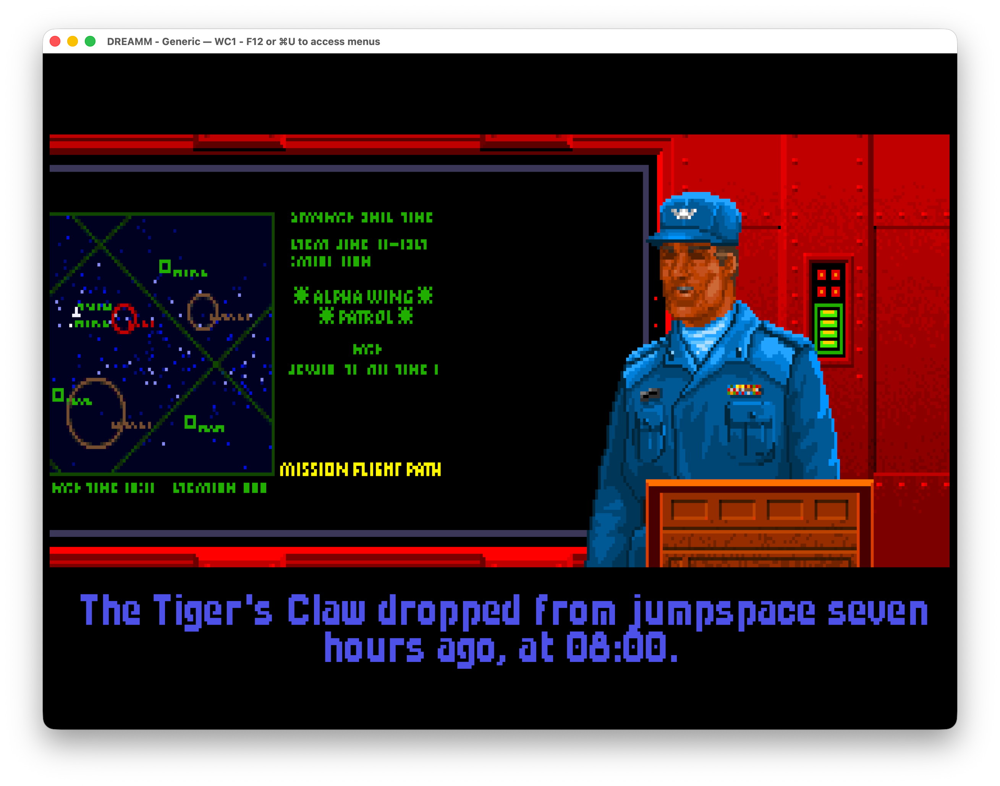
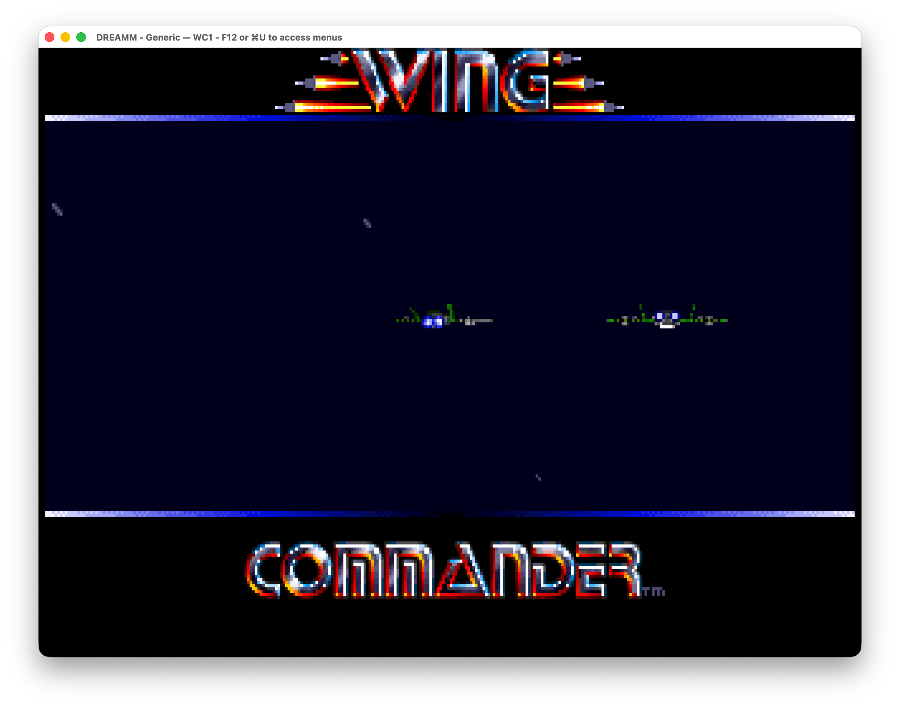
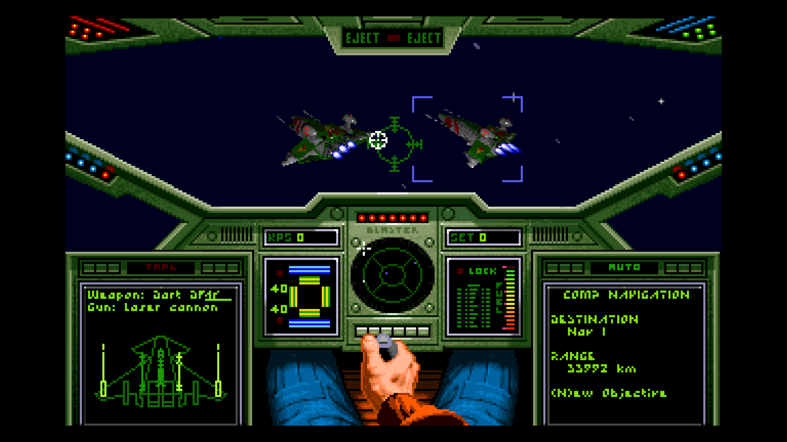
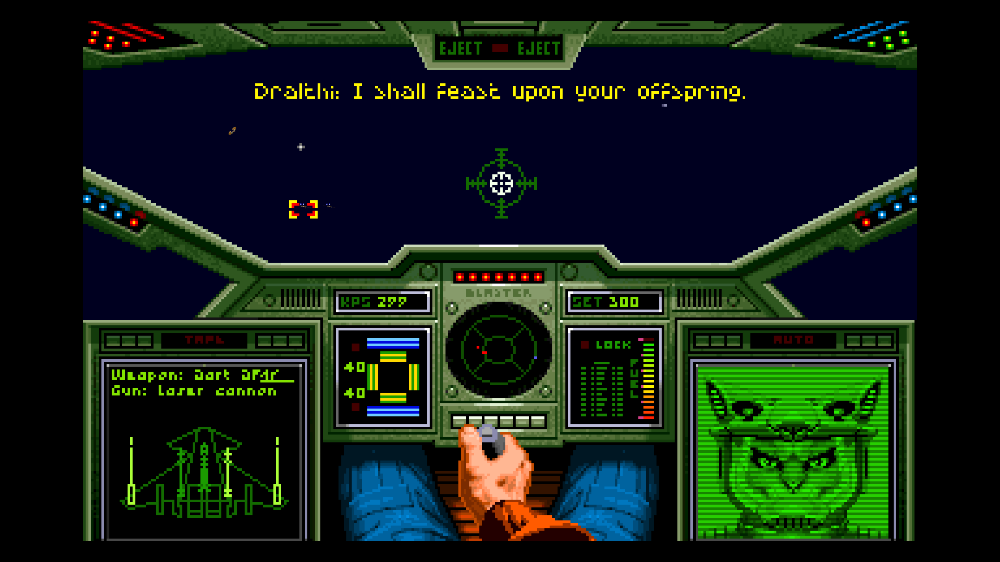

# Wing Commander source reconstruction and SDL2 port

This project recreates the source of **Wing Commander** as shipped in *Wing
Commander: The Kilrathi Saga* (1996). The rebuilt `WC1.EXE` matches the
original byte for byte.

It also provides a native port for Windows, Linux, and macOS that plays the
Kilrathi Saga and FM Towns versions, the original DOS release (in part), and the
Super Wing Commander Mac demo.

No original game data or Sega CD voice recordings are included.

If you find this project useful, you can [support its development through
GitHub Sponsors](https://github.com/sponsors/neuromancer).

## Screenshots

| Mission briefing | Tiger's Claw hangar |
| --- | --- |
| [](screenshots/mission-briefing.png) | [](screenshots/tigers-claw-hangar.png) |

| Title sequence | Cockpit combat |
| --- | --- |
| [](screenshots/title-screen.png) | [](screenshots/cockpit-combat.png) |

## Download and play

Download the package for your platform from
[GitHub Releases](https://github.com/neuromancer/wc1-re/releases):

- **macOS 15 or later:** open the `.dmg` for Apple Silicon (`arm64`) or Intel
  (`x86_64`) and drag **Wing Commander** into **Applications**.
- **Windows:** run the `-setup.exe` installer, then open **Wing Commander**
  from the Start Menu.
- **Steam Deck / Linux:** in Desktop Mode, install the `.flatpak` with
  `flatpak install --user ./downloaded.flatpak` (replace the filename), then add
  **Wing Commander** to Steam as a non-Steam game. In Game Mode the launcher
  fills the screen, with its settings and controls in tabs and the joystick
  calibration in the same window.
- **Portable ZIPs** for Windows, macOS, and Linux: extract and run, keeping the
  bundled files together.

Game data is not included. Open the app, choose a detected installation or use
**Add path…** to select the game's folder: a Steam or GOG copy's main folder,
or any folder containing `GAMEDAT`. Then select **Start WC1**. The launcher
remembers your folder and options.

- **Secret Missions:** with Kilrathi Saga or DOS data that includes the
  expansions, the launcher also offers **Start SM1** and **Start SM2**, and can
  transfer a pilot from an existing save with their statistics and awards. Both
  releases play the expansions the same way, following the Kilrathi Saga, but
  SM2's captured Dralthi keeps its DOS disguise: in the stealth missions the
  Kilrathi ignore it until it fires on them. With DOS data, SM2 keeps its
  saved games in `GAMEDAT/CRUSADE.WLD`, as the DOS release does, so your DOS
  SM2 saves carry over.
- **Languages:** choose **Español**, **Français**, or **Japanese (FM Towns)**
  in the launcher's **Language** menu.
- **German fan translation:** a DOS installation you have patched yourself
  with the German fan translation shows its German text, including the menus
  and cockpit messages it translates in `WC.EXE`. The launcher's **Language**
  menu then shows **German** only, and some artwork may stay in English.
- **Roland MT-32 music:** the DOS scores can play on an emulated MT-32 or
  CM-32L. Put your own control and PCM ROM files in a folder, choose
  **Roland MT-32** under **Music** in the launcher, and select the folder with
  **MT-32 ROMs…**. The launcher names the machine it found, preferring the
  CM-32L. The MT-32 plays the sound effects too, sharing its channels with the
  music as the original does. A *Kilrathi Saga* installation can instead keep
  its own digital music or play the AdLib scores, and both keep its digital
  sound effects. Without usable ROMs the game plays the AdLib music. The
  command line takes `--music=default|adlib|mt32`,
  `--mt32-roms=DIR`, `--mt32-model=ID` (such as `mt32_1_07`) and
  `--mt32-check`, which reports what a ROM folder holds.
- **FM Towns:** copy `WC.EXP` and the complete `GAMEDAT` folder from your CD
  into a writable folder and select it. For CD music, keep the disc image and
  place its CUE sheet beside `WC.EXP` as `TOWNS.CUE`.
- **Sega CD voices:** if you own the Sega CD recordings, put them in
  `Data/Voice` beside `GAMEDAT` to hear voiced WC1 dialogue and radio messages.
- **Super Wing Commander demo:** download the
  [Mac demo](https://archive.org/details/super-wing-commander-demo-1.0.2-mac),
  unzip it, and select its `SuperWing DEMO` folder.
- **Autosave:** the game saves to slot 8 after starting or loading a campaign
  and after each mission you survive; manual saves use slots 1–7. You can turn
  it off under **Gameplay**.

## Improvements

- Resizable window, fullscreen, and aspect-correct 4:3 presentation.
- Gamepad support, rumble, and alternative joystick layouts, including
  WCAT-style four-button controls and, for WC1, a Custom mode that rebinds
  every gamepad button, trigger and stick axis.
- An adjustable joystick dead zone (22% by default, as in the original) and a
  launcher page that calibrates WC1's joystick. It writes `GAMEDAT/j.cal` as
  the game's own calibration does, and the game now reads all of that file,
  not only the centre.
- Launcher tabs that show the gamepad, keyboard and mouse bindings for WC1
  and Super Wing Commander and let you rebind keys, mouse buttons and the
  wheel.
- Fixes to the 1996 release, such as correctly scaled planets, static on
  knocked-out cockpit displays, landing on the *Tiger's Claw* from any
  direction, and `Esc` pausing spaceflight.
- Sound effects balanced against the music and panned with the camera, and
  mouse wheel throttle control.
- Optional extras: an enhanced renderer that draws ships at full resolution
  while keeping the original artwork, cockpit, and HUD; EGA colours; the
  restored startup intro; a cockpitless view; and a cheat mode.

| Enhanced renderer | Enhanced cockpit combat |
| --- | --- |
| [](screenshots/enhanced-space-objects.webp) | [](screenshots/enhanced-cockpit-combat.webp) |

## Controls

| Shortcut | Action |
| --- | --- |
| `Cmd+Enter` (macOS), `Alt+Enter` (Windows and Linux) | Toggle fullscreen |
| `Cmd+Q` (macOS) | Quit the game |
| `Ctrl+S` / `Ctrl+M` (spaceflight) | Toggle sound effects / music |
| `Esc` (spaceflight) | Pause; press any key to resume |
| Mouse wheel (spaceflight) | Increase or decrease speed |
| Gamepad RT / LT (spaceflight) | Same as A / B: fire guns / roll and speed (missiles in the WCAT layouts) |
| Gamepad Start (spaceflight) | Pause or resume |
| Gamepad Back | Cycle views in spaceflight; Escape/back elsewhere |
| Gamepad Y (`Y/N` prompts) | Confirm Yes |
| `J` (main menu, barracks), `Ctrl+J` (spaceflight) | Calibrate the joystick, as in the original |

The launcher's **Joystick** and **Keyboard and mouse** tabs show every
binding. Click a key or mouse input to change it, or **+** to add a second one;
changes apply when the game starts. `Esc`, and Super Wing Commander's menu
shortcuts and in-flight computer keys, cannot be changed.

In the Joystick tab's **Custom** control mode, click any input on the gamepad
drawing to rebind it for WC1's spaceflight, and point at a choice to see what
it does. A button or trigger can take any
flight key's action, cycle the views, or turn yaw into roll and pitch into
speed while held. A stick axis or trigger can pitch, yaw, roll or change speed,
and a stick axis can also set the throttle; any of these can be reversed.
Custom starts from the WCAT four-button, four-axis layout. Menus keep their
fixed buttons, and Super Wing Commander keeps the WCAT four-axis layout.

As in the original, a mission ends only by landing on the *Tiger's Claw*,
ejecting, or dying; quit from the barracks menu.

## Build from source

```sh
git submodule update --init --recursive
make -j modern-gui
```

This needs Python 3.10+, a C/C++ compiler, the SDL2 and LZO2 development
packages, CMake, Rust, and a C++20 compiler; the game is written to
`out-modern/`. `make -j` rebuilds the original `WC1.EXE`.

## Acknowledgements

Special thanks to:

- [Origin Systems](https://en.wikipedia.org/wiki/Origin_Systems)
  who created *Wing Commander* and developed its *Kilrathi Saga* port;
- [Electronic Arts](https://www.ea.com/) for publishing *Wing Commander: The
  Kilrathi Saga*;
- [GOG](https://www.gog.com/en/game/wing_commander_1_2) for keeping *Wing
  Commander 1 + 2* readily available;
- AllTinker for the [W.C.A.T. overhaul](https://alltinker.itch.io/wcat), whose
  fixes and analysis of the DOS release have been valuable references;
- the [WCDX project](https://github.com/Bekenn/wcdx) for its pioneering
  compatibility work on the *Kilrathi Saga* release;
- L@Zar0 and darkpadawan for the Spanish translation v1.1; its
  [original terms](translations/upstream/Leeme.txt) specify GPLv3 with an additional
  no-charge condition. [Provenance](translations/provenance.json) records the import;
- WingLoader v0.91 for the initial associations between dialogue and recording filenames;
- [Greg14](https://www.wcnews.com/chatzone/members/greg14.11738/) for the French
  translation, adapted with permission; [provenance](translations/fr/provenance.json);
- Aaron Giles for the [DREAMM emulator](https://dreamm.aarongiles.com/), used
  to run and study the original release, and
  [ymfm](https://github.com/aaronsgiles/ymfm), which powers the SDL2 port's
  AdLib emulation;
- the [Munt project](https://github.com/munt/munt), whose libmt32emu
  (LGPL-2.1 or later) emulates the Roland MT-32 and CM-32L; and
- DaisenryakuFan for providing very advanced source reconstructions for the DOS
  releases of several *Wing Commander* titles.

## License

See [LICENSE](LICENSE). OpenAI Codex and Anthropic Claude were used during the
reconstruction.
